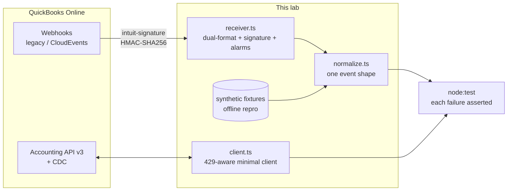

# QuickBooks Sync Reliability Lab

[](https://github.com/me-Shahsavan/quickbooks-sync-reliability-lab/actions/workflows/ci.yml)

> A failure-mode catalog for QuickBooks Online integrations — every entry reproducible,
> every fix a runbook.

Accounting sync failures have a property most software failures don't: **they are
discovered by accountants, not by monitoring.** Nothing crashes. Two ledgers quietly
drift, and the damage surfaces at month-end reconciliation as lost trust. Every team
that integrates with QuickBooks relearns the same failure modes the hard way, in
production, on customer data.

This lab documents those failure modes the way an SRE team would: each one **reproduced
in code**, with a **detection strategy**, an **operational runbook**, and a **blameless
postmortem** showing how it plays out when missed.

```bash
npm install && npm test   # reproduces chapter 01 offline in ~30 seconds — no Intuit account needed
```

## The catalog

**Published — reproducible today:**

| # | Failure mode | Severity |
|---|---|---|
| 01 | [The CloudEvents migration: how your webhooks silently stop](failures/01-cloudevents-migration/README.md) | High — silent data loss |

**Known, not yet written up** — failure modes already mapped, listed by how silently
each one damages data. No schedule implied; what's published above is what exists:

| # | Failure mode | Severity |
|---|---|---|
| 02 | SyncToken races: two writers, one invoice, and the stale-object error (5010) you must re-read before retrying | High |
| 03 | The sparse-update trap: how a full-object update nulls fields you never touched | High — data loss |
| 04 | CDC's 30-day window: when your safety net expires | Medium |
| 05 | 429 storms: jittered backoff vs. synchronized retry stampedes — the ecosystem-generic version (class-based retry, jitter, tests) is built in the [Salesforce lab](https://github.com/me-Shahsavan/salesforce-sync-reliability-lab) | Medium |
| 06 | Duplicates from overlapping sync paths, and idempotent write design | High |
| 07 | The 100-day refresh token (and its new 5-year ceiling) | Medium |
| 08 | Canary reconciliation: measuring your webhook pipeline's real miss rate | — (tooling) |

Each chapter follows the same shape:

**Context → What breaks → Reproduce it → Detect it → Runbook → Postmortem → The deeper lesson**

## Why these artifacts

Reliability work is only as good as its operational artifacts. Alongside the code:

- **[RFC-001 — What a trustworthy sync looks like](docs/rfc-001-trustworthy-sync.md)** —
  the six design principles every chapter tests against, with alternatives considered.
- **[SLOs for a two-way accounting sync](docs/slo.md)** — freshness, delivery coverage,
  divergence, and write safety, with measurement methods and an error-budget policy.
  Transport metrics stay green through most real sync failures; these don't.
- **[Decision log](docs/decisions.md)** — why a lab and not a product, why fixtures
  before sandbox, why no SDK, and the clean-room sourcing policy.
- Per chapter: a **runbook** (e.g. [migrating webhooks to CloudEvents](failures/01-cloudevents-migration/runbook.md))
  and a **simulated postmortem** in Google SRE format
  (e.g. [19 days of silently dropped events](failures/01-cloudevents-migration/postmortem.md)).

## How the harness is organized



- `src/webhooks/` — dual-format payload parsing, signature validation over raw bytes,
  and a reference receiver whose `unknownFormat` counter is the single most important
  alarm in this repo.
- `src/qbo/` — a deliberately minimal typed API client (visible requests beat SDK
  abstraction when the subject *is* the failure behavior).
- `failures/<nn>-<name>/` — one directory per failure mode: README, fixtures, runbook,
  postmortem.
- Every chapter runs offline first, from synthetic fixtures that follow Intuit's
  documented payload shapes; pointing it at your own sandbox company is the optional
  second step (`.env.example`).

## Method & sources

Everything here derives from **public sources only**: Intuit's developer documentation
and blog, Intuit's official sample apps, public developer-forum threads, and
experiments against my own sandbox company. No employer code, data, or internal
designs — see the [clean-room policy](docs/decisions.md#d-000--clean-room-sourcing-policy).
Platform behaviors that public docs leave ambiguous are listed as open questions in the
RFC rather than asserted from memory.

Platform facts (deadlines, limits, formats) were verified against Intuit's developer
portal as of **July 2026** — always confirm current values before relying on them.

Drafting and review were done with AI assistance, which the commit history shows. The
judgment calls are mine, and the verification is what makes them trustworthy: every
platform fact traces to a public Intuit source, and every reliability claim in this
README is pinned to a test in `test/` that you can run offline in about 30 seconds.

## Status & siblings

Chapter 01 is complete and reproducible today; the rest of the catalog is mapped but
deliberately unwritten — a listed failure mode is a claim I can defend, a written
chapter is a claim you can run.

This lab has a sibling:
**[salesforce-sync-reliability-lab](https://github.com/me-Shahsavan/salesforce-sync-reliability-lab)** —
the same method (failure catalog, class-based retry tree, honest limits doc) applied
to a different ecosystem, built the opposite way around: instead of reproducing known
failures from public docs, it stands up a live org and captures what the API actually
returns, verbatim — including the predictions that turned out wrong.

Found a failure mode this catalog is missing, or a fixture that drifted from current
platform behavior? Issues and PRs welcome.

## About

Built by **[Ehsan Shahsavan](https://github.com/me-Shahsavan)** — Technical Product
Manager focused on integrations and data-sync systems. I've spent the last few years
building and operating two-way sync between SMB SaaS products and accounting/commerce
platforms; this lab is the public, clean-room version of the scar tissue.

*Not affiliated with or endorsed by Intuit Inc. QuickBooks is a trademark of Intuit Inc.
Licensed MIT.*
